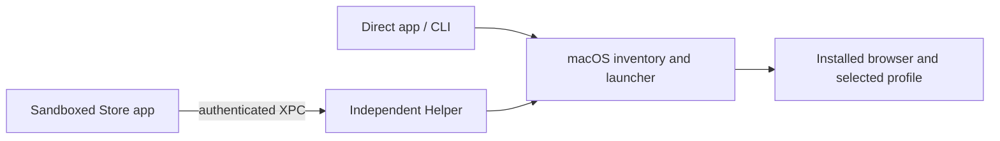

# Optional browser Helper

The App Store application remains sandboxed and works by itself for browser-level
routing. Installing and opening **LinkPilot Helper.app** separately enables
Chrome and Brave profile targets. It is a native companion, not a browser
extension. The direct GitHub/Homebrew application does not require it.



## Shared ownership

- `linkpilot-core` continues to own rules, target schemas and profile parsers.
- `linkpilot-platform-mac` owns the registry and browser launch strategies. Both
  the direct provider and Helper use this implementation; there is no second
  routing engine or duplicated browser registry.
- `linkpilot-helper-ipc` defines protocol version 1, capabilities, validation and
  the native XPC transport. It does not expose the daemon's configuration API.
- `linkpilot-browser-helper` is a separately packaged application and per-user
  service. Store never contains or directly executes its binary.

The protocol offers only status, profile enumeration and HTTP/HTTPS opening.
Clients supply browser/profile identifiers, never executable paths, scripts,
shell arguments, arbitrary files, or configuration changes. Frames are bounded
to 64 KiB and each exchange has a three-second deadline. Open is not retried
automatically because a missing reply can follow a successful browser launch.

## Trust and sandbox boundary

The Mach service name is `<signing-team>.app.linkpilot.helper`. Both applications
declare the macOS App Group `<signing-team>.app.linkpilot`. Team-ID-prefixed
groups are validated by macOS without a separate portal registration or a new
provisioning profile. The local build obtains the team from the certificate's
subject OU; an Apple Development certificate's common-name suffix identifies
the person and must not be used as the team.

XPC uses Apple's peer code-signing requirement API on macOS 12+. The Helper
accepts only the same signing team's Store app, direct app, or Helper diagnostic
client. Clients require the same team's `app.linkpilot.helper` identity. Both
requirements include Apple's trust anchor. Unsigned/ad-hoc builds have no
fallback access. A non-sensitive hello is authenticated on the same connection
before transmitting a URL or profile data; a spoofed service cannot receive
that data as its first message.

There are no temporary sandbox exceptions, network listener, root daemon,
Accessibility scripts or browser-extension requirement. Browser data access
belongs to Helper's own macOS privacy entry. Enable only the intended browsers
under **Privacy & Security → Files & Folders → LinkPilot Helper**, then rescan.
Full Disk Access is unnecessary. Denials are retained as errors, not empty
success responses. No history or Cookies are read.

## Installation, lifecycle and failure behavior

1. Extract the architecture-matched `LinkPilot_Helper_<version>_<arch>.zip`
   from the official GitHub release and move the app to `/Applications`.
2. Open it once. The external app registers its own on-demand, per-user Mach
   service in `~/Library/LaunchAgents/<signing-team>.app.linkpilot.helper.plist`. Store performs
   no LaunchAgent writes. Moving the Helper afterward requires opening it again
   to refresh the registered executable path.
3. In Store's Browsers or Settings page, check the Helper connection and grant
   Chrome/Brave data access when needed. Profile targets use the existing config
   schema, rule editor, default-target editor and Ask picker.
4. The service activates on demand after login without opening a client window.
   **Disable LinkPilot Helper** in its menu stops/unregisters the service. The
   diagnostic `linkpilot-helper disable` command does the same.

Without Helper, plain browser routes continue using sandbox-compatible
NSWorkspace APIs. Saved profile targets remain intact while it is offline.
Missing, untrusted, incompatible or permission-denied Helper operations produce
an error; a failed selected profile/mode never falls back to an active/default
profile. A profile is checked against fresh inventory immediately before launch.

The initial Helper capability list is **Chrome and Brave only**. Safari, Arc,
Firefox-family and other Chromium products retain browser-level Store routing.
Add a browser only after proving its profile launch behavior, not merely that
its files can be parsed. Source-browser/profile matching and keep-source still
require browser integration and remain unavailable in Store.

## Build and verification

```sh
cargo build --locked -p linkpilot-browser-helper
python3 apps/desktop/scripts/package-helper.py \
  --binary target/debug/linkpilot-helper \
  --output target/helper-local \
  --identity '<Apple Development certificate SHA-1>' \
  --version '<workspace version>' --development
python3 scripts/test_helper_integration.py \
  --helper 'target/helper-local/LinkPilot Helper.app' \
  --identity '<same certificate SHA-1>'
```

Disable any running Helper before the isolated integration test. It registers
only a temporary service, leaves production config untouched, and tests real
signed sandbox communication, wrong client/server identities, missing service,
and duplicate-registration rejection. No browser data is accessed by that test.
The ordinary Rust tests also reject incompatible protocols, extra command
fields, unsafe profile IDs, non-web URLs and oversized requests.

On 2026-11-09, development-signed Store and Helper builds on Apple Silicon:

- Passed all five real XPC authentication/lifecycle checks.
- Enumerated 10 Chrome profiles and one Brave profile after granting only those
  two browser-data permissions.
- Delivered a unique link from Store's Test URL page to a non-default Chrome
  profile, confirmed by that profile's browser connection and native window.
- Delivered a different link to Brave's explicit `Default` target; its version
  page confirmed the profile path. Test configuration was restored byte-for-byte.

The release workflow builds both architectures, independently Developer-ID
signs and notarizes Helper, staples the application, runs the signed integration
test, and publishes a ZIP plus checksums. Store itself still updates only through
Apple. Helper updates are separate; no Helper auto-update mechanism is included.
Local tests are not Developer ID notarization, Intel runtime proof or App Review
acceptance. Update Store metadata/review notes to disclose the optional companion
before submitting the new Store build; do not promise profile features without
the installation requirement.

References: [Apple App Groups](https://developer.apple.com/documentation/xcode/accessing-app-group-containers),
[App Group IPC naming](https://developer.apple.com/documentation/bundleresources/entitlements/com.apple.security.application-groups),
[Apple XPC authentication guidance](https://developer.apple.com/forums/thread/681053).
